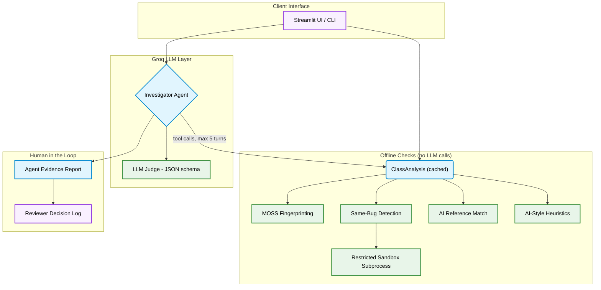

# Code Sentinel

An evidence-based integrity triage system for coding assessments, powered by MOSS-style fingerprinting, a Groq LLM investigator and Streamlit.

> **Live Deployments:**
> * **Interactive Streamlit App:** [code-sentinel.streamlit.app](https://code-sentinel.streamlit.app/)

---

## Overview

Code Sentinel is an integrity triage system for programming assessments designed to assist instructors in determining **whom to ask a follow-up interview question**, rather than issuing automated accusations of plagiarism. It aggregates orthogonal dimensions of empirical evidence: winnowed k-gram token fingerprinting (MOSS-style structural copying), identical test case failure signatures across independent student solutions, lexical similarity against AI reference answers, and heuristic styling signals.

A tool-using Groq LLM investigator agent analyzes flagged evidence, cites specific lines of code, and synthesizes structured interview questions for human reviewers to evaluate.

> **Guiding Principle:** The system flags anomalies; humans make decisions.

---

## Architecture Overview



---

## Features

| Feature | Description |
| ------- | ----------- |
| **MOSS-Style Fingerprinting** | Normalizes AST tokens, identifier names, strings, and numeric constants; executes k-gram hashing and winnowing (Schleimer et al., SIGMOD 2003) |
| **Same-Bug Identification** | Executes submissions against hidden test cases in sandboxed subprocesses, grouping solutions that produce identical erroneous outputs |
| **AI Reference Match** | Generates zero-shot reference implementations across frontier models, benchmarking submissions against AI code signatures |
| **Stylometric Heuristics** | Rule-based syntactic analysis (naming conventions, docstrings, type annotations, comment density) with optional LLM JSON structured outputs |
| **Autonomous Investigator Agent** | Multi-turn Groq agent dynamically calling investigation tools, citing matching source lines, and generating viva interview questions |
| **Human Review Decision Log** | Atomic JSON audit trail recording reviewer verdicts (Clear, Schedule Follow-up, Escalate) bound to investigator evidence reports |
| **Empirical Evaluation Harness** | Ground-truth benchmarking suite measuring precision, recall, and false-positive rates across human and synthetic code |

---

## Technology Stack

| Component | Technologies |
| :-------- | :----------- |
| **LLM Inference** | `Groq` API (`openai/gpt-oss-120b`) |
| **User Interface** | `Streamlit`, `Pandas` |
| **Detection Core** | Custom DFA lexer, rolling k-gram hashing, winnowing algorithm |
| **Code Execution Sandbox** | Isolated `subprocess` sandbox with timeouts, memory limits, and sanitized environments |
| **Testing & Quality** | `pytest`, Streamlit `AppTest`, `ruff`, `mypy`, GitHub Actions |
| **Embeddings (Optional)** | `fastembed` (`jina-embeddings-v2-base-code`) |
| **Containerization** | `Docker` (non-root execution), Dev Containers |

---

## Project Structure

```
Code-Sentinel/
├── app.py                          # Streamlit multi-tab user interface
├── codesentinel/
│   ├── agent.py                    # Tool-using LLM investigator agent
│   ├── ai_style.py                 # Heuristic and LLM-judge code style analysis
│   ├── analysis.py                 # Cached class-wide analysis coordinator
│   ├── cli.py                      # Command-line interface subcommands
│   ├── config.py                   # System thresholds, model settings, and paths
│   ├── embeddings.py               # Optional vector code embeddings
│   ├── evaluation.py               # Precision, recall, and FPR evaluation suite
│   ├── llm.py                      # Groq client wrapper with token accounting
│   ├── moss.py                     # k-gram hashing, winnowing, and fingerprint matching
│   ├── problems.py                 # Assessment problem specifications and test cases
│   ├── reference.py                # Synthetic AI reference generator
│   ├── reviews.py                  # Atomic human reviewer decision log
│   ├── sandbox.py                  # Process sandbox for untrusted code execution
│   ├── same_bug.py                 # Identical wrong output grouping engine
│   └── tokenizer.py                # DFA lexer and token normalizer
├── data/
│   ├── problems/                   # Problem descriptions, starters, tests, and submissions
│   ├── evals/                      # Ground-truth evaluation benchmarks
│   └── samples/                    # Example code pairs
├── tests/
│   ├── conftest.py
│   ├── test_core.py                # Tokenizer, MOSS, and sandbox unit tests
│   ├── test_agent_and_reviews.py   # Agent execution and review log tests
│   └── test_app.py                 # Headless Streamlit AppTest scenarios
├── Dockerfile                      # Non-root container definition
├── Makefile                        # Developer automation shortcuts
├── pyproject.toml                  # Project packaging and linting rules
└── README.md
```

---

## Setup and Installation

### Prerequisites

- Python 3.10+
- A [Groq API key](https://console.groq.com/keys) (Optional for offline MOSS and same-bug checks)

### 1. Clone the repository

```bash
git clone https://github.com/Shashank17singh/Code-Sentinel.git
cd Code-Sentinel
```

### 2. Install dependencies

```bash
python -m venv .venv
# Linux / macOS:
source .venv/bin/activate
# Windows:
.venv\Scripts\activate

pip install -r requirements.txt
```

### 3. Configure environment variables

Create a `.env` file in the project root:

```env
GROQ_API_KEY=your_api_key_here
```

### 4. Run the application

```bash
streamlit run app.py
```

### 5. Command-Line Interface

```bash
# Run an offline MOSS scan across a problem cohort
python -m codesentinel scan longest_substring

# View side-by-side matching lines between two submissions
python -m codesentinel moss longest_substring --show alice bob

# Run same-bug grouping across failed hidden tests
python -m codesentinel same-bug longest_substring

# Run the agentic investigator on a specific candidate
python -m codesentinel agent longest_substring divya
```

---

## Running the Tests

Execute the automated test suite:

```bash
pytest tests/
```

Run static code analysis and linting:

```bash
ruff check .
mypy codesentinel
```

---

## Deployment

The application is containerized and configured to run as an unprivileged user:

```bash
docker build -t code-sentinel .
docker run --rm -p 8501:8501 -e GROQ_API_KEY=your_key code-sentinel
```

Live deployment is hosted on Streamlit Community Cloud at [code-sentinel.streamlit.app](https://code-sentinel.streamlit.app/).

---

## Evaluation Results

Measured against a curated benchmark of 30 code samples (12 AI-generated, 9 tidy-human, 9 messy-human):

| Detector | Precision | Recall | False-Positive Rate |
| :------- | :-------: | :----: | :-----------------: |
| Heuristic | 69% | 75% | 22% |
| AI Reference Match | 50% | 50% | 33% |
| LLM Judge | 86% | 50% | 6% |
| Combined Consensus (2+ agree) | 75% | 50% | 11% |

---

## Known Limitations

- **Heuristic Indicators:** High-discipline human programmers write clean, well-documented code that can share structural patterns with frontier AI models; flags must be verified via human review.
- **Subprocess Sandbox:** The execution sandbox isolates memory and limits runtime durations, but does not provide complete kernel virtualization; untrusted execution on public instances is disabled by default.

---

## Deep Codebase Analysis

| Module | Architectural Responsibilities |
| :----- | :----------------------------- |
| `app.py` | Multi-view interface coordinating class analysis, pairwise diffs, and audit logs |
| `codesentinel/agent.py` | ReAct investigator workflow executing tool queries up to a 5-turn limit |
| `codesentinel/moss.py` | Pure-Python winnowing and fingerprint intersection algorithms |
| `codesentinel/same_bug.py` | Concurrently evaluates student code against test suites to group identical failure outputs |
| `codesentinel/sandbox.py` | Subprocess runner applying CPU timeouts, memory caps, and scrubbed environment variables |
| `codesentinel/reviews.py` | Atomic read-modify-write JSON reviewer ledger |

---

## License

This project is licensed under the MIT License. See [LICENSE](LICENSE) for details.
